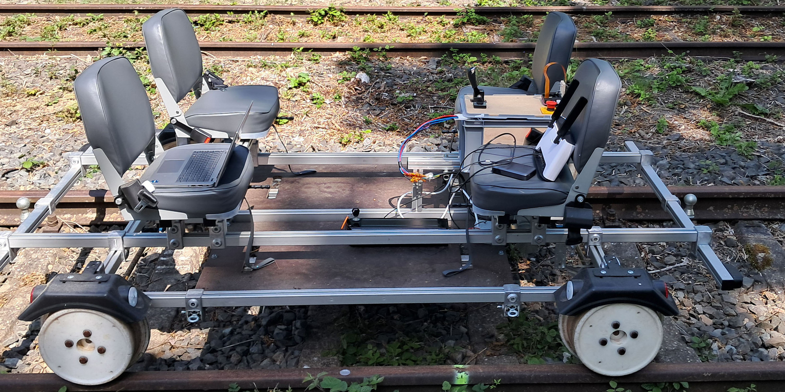
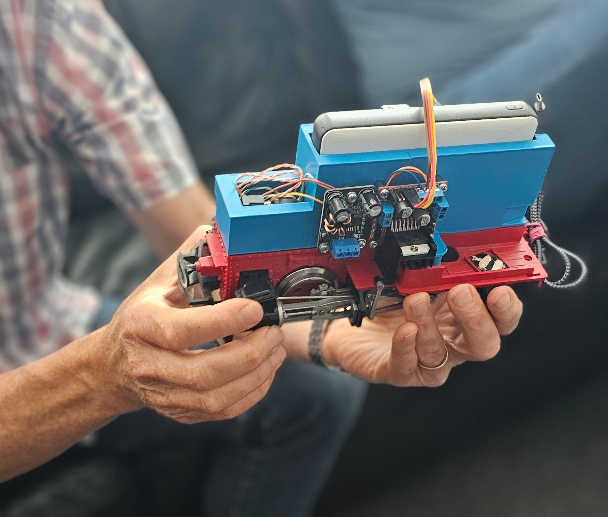
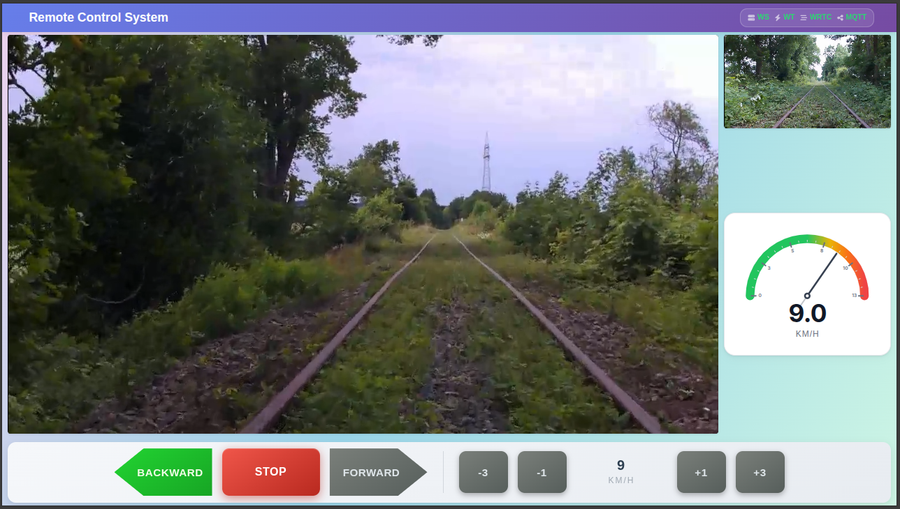

# Research on Remote Control System

## Project overview

This project researches the design and evaluation of real-time, safety-critical
remote train control systems. It investigates how control commands, sensor
measurements, telemetry, and video can be communicated between train-side
equipment, infrastructure, and a remote operator interface while meeting
stringent timing and dependability requirements.

The work examines network protocols and transport technologies including
**WebTransport**, **QUIC**, **WebRTC**, **WebSocket**, and **MQTT over TCP**,
among others. The research focuses on their communication characteristics,
timing constraints, and suitability for transmitting control and sensor data
in cyber-physical systems (CPS).

An additional research question is the feasibility of using **Lingua Franca**
to coordinate and orchestrate components in such CPS, particularly where
time-sensitive interactions and predictable behavior are important.

This research is a product of the **REAKT-DataTrain Project**. The software and
test platforms described here support research and evaluation; they are not,
by themselves, evidence of certification or approval for operational railway
use.

## Research scope

The project investigates:

- Communication architectures for remote train control.
- Protocol behavior and trade-offs across WebTransport, QUIC, WebRTC,
  WebSocket, MQTT over TCP, and other relevant technologies.
- Timing constraints for control, telemetry, sensor-data, and video
  transmission.
- The feasibility of applying Lingua Franca to orchestration in real-time CPS.
- The design of a remote control interface for monitoring and controlling
  train systems.

The repository contains software for train-side, server-side, and web-client
components that can be used in these research activities. Specific protocol
support and behavior depend on the component and its configuration.

## Test platforms

The research is designed for testing on **REAKTOR** and **REAKTiny**.

### REAKTOR

Test platform reference dated **29 June 2026**.

### REAKTiny

Test platform reference dated **4 September 2025**.

## Remote control interface

The project also researches how a remote control interface can present
operational information and support remote interaction with train systems.

## Publication

The following publication is currently associated with this project:

> **“Remote Train Control over WebTransport Orchestrated by Lingua Franca”**
>
> *IEEE Embedded Systems Letters*
>
> [https://doi.org/10.1109/LES.2026.3727940](https://doi.org/10.1109/LES.2026.3727940)

## License

This project is licensed under the MIT License. See [LICENSE](LICENSE) for
details.
